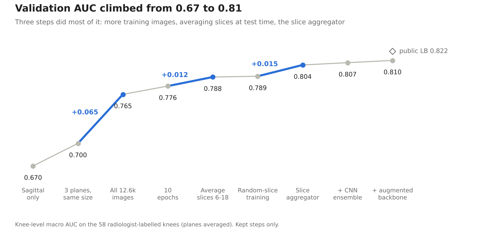

# RSNA Knee MRI Abnormality Detection

Predicting 12 knee abnormalities (ligament and meniscus tears, osteoarthritis, effusion, fractures and more) from multi-plane knee MRI, for the [RSNA Knee Abnormality Detection](https://www.kaggle.com/) Kaggle competition.

📄 **Full write-up: [WRITEUP.md](WRITEUP.md)**, including a [notebook-by-notebook account](WRITEUP.md#notebook-by-notebook) of every experiment.



## Approach

1. **Preprocess** each study's fluid-sensitive sagittal, coronal and axial series into 24 × 224 × 224 volumes.
2. **Label** 4,400 unlabelled studies by having an LLM (Qwen2.5-7B) read their radiology reports.
3. **Train** 2D ResNets on random middle slices from all three planes; average slices 6–18 at test time.
4. **Aggregate** each scan's slice features with a small ordered transformer instead of a plain average, and blend it with a CNN ensemble.

## Results

| Submission | Validation AUC (58 knees) | Public LB |
| --- | --- | --- |
| Single ResNet-18 | 0.789 | 0.798 |
| 4-model CNN ensemble | 0.789 | 0.795 |
| Ensemble + slice aggregator | 0.807 | 0.822 |
| **Final: ensemble + aggregators on original and augmented backbones** | **0.810** | **0.822** |

## Repository layout

| Folder | Notebooks |
| --- | --- |
| `notebooks/00_labels/` | EDA and LLM report labelling (Sherry); Fracture/MCL label audit (Cristina) |
| `notebooks/01_data/` | 02 preprocessing for all planes; Dataset and DataLoader checks (Cristina) |
| `notebooks/02_training/` | 14 ResNet-18 · 15 ResNet-34 · 17 v1 labels · 17v2 v2 labels · 14aug augmented; augmentation design (Cristina) |
| `notebooks/03_aggregator/` | 18 and 18aug slice-feature extraction · 19b and 19e aggregator training |
| `notebooks/04_submission/` | 16e final offline inference notebook |
| `notebooks/experiments/` | 05–13 early experiments · 16, 16b, 16c, 16d earlier submissions · 17e ensemble check · 18v2, 19, 19c aggregator variants · 20 multi-plane aggregator |
| `images/` | Figures used in the write-up |

Each notebook is explained in [WRITEUP.md → Notebook by notebook](WRITEUP.md#notebook-by-notebook).

## How to run

Run in this order on Kaggle, attaching each notebook's outputs as the next one's input:

1. `01_data/02_*`: preprocess all planes (CPU, ~30 min).
2. `00_labels/`: LLM report labels (2 × T4, ~45 min). Optional; the main models also train on the original labels.
3. `02_training/`: train the CNNs (T4 GPU, ~1–2 h each).
4. `03_aggregator/`: extract slice features (GPU, ~10 min), then train the aggregators (CPU, ~20 min).
5. `04_submission/16e_*`: attach all weights and submit (internet off; ~5 h of the 9 h limit).

### Pulling the notebooks from Kaggle

`pull_notebooks.sh` downloads all of my Kaggle notebooks and sorts them into the folders above by their number prefix:

```bash
pip install kaggle               # needs ~/.kaggle/kaggle.json (never commit it)
bash pull_notebooks.sh
```

Anything it can't match goes to `notebooks/_unsorted/` for manual sorting.

## Data

Competition data, preprocessed arrays, LLM labels and model weights are **not included**, per the competition rules. Download the data from the competition page.

## What did not work

Multi-slice channel inputs, max pooling over slices, a bigger backbone alone, position-only slice weighting, and a joint multi-plane aggregator. Details: [WRITEUP.md → What did not work](WRITEUP.md#what-did-not-work).

## Team

Alex Tanasescu, Sherry, Cristina and Filip.
