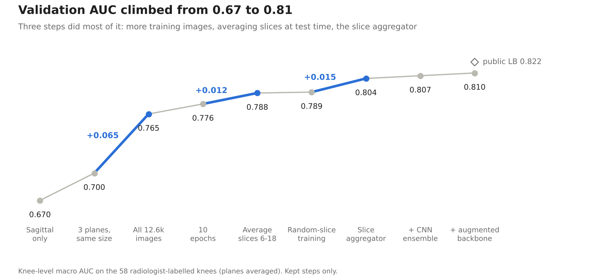
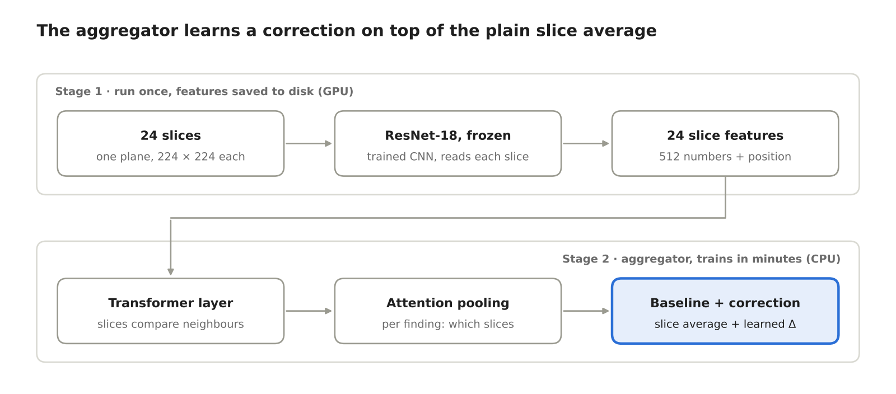

# Knee MRI Abnormality Detection: From 0.67 to 0.82

**RSNA Knee Abnormality Detection · Kaggle · October 2026**
Alex Tanasescu, Sherriff Kadiri and Cristina Bindiu

This was my first Kaggle competition, and one of the most rewarding projects I've worked on. In one week I went from raw DICOM files to a submission running offline under a time limit, and learned the parts of machine learning that tutorials skip: validating honestly on a tiny labelled set, telling a real improvement from noise, recovering from runs that silently failed, and choosing final submissions under uncertainty. This write-up covers what worked, what didn't, and why.

**Result:** public leaderboard macro AUC **0.822**, up from a first baseline of 0.67 on our validation set. Private leaderboard: *[score, rank 4977 of 6299]*.

---

## Contents

1. [TL;DR](#tldr)
2. [The problem](#the-problem)
3. [Data and preprocessing](#data-and-preprocessing)
4. [Labels from radiology reports](#labels-from-radiology-reports)
5. [Validation: measuring honestly on 58 knees](#validation-measuring-honestly-on-58-knees)
6. [The CNN: from one slice to all planes](#the-cnn-from-one-slice-to-all-planes)
7. [The ordered slice aggregator](#the-ordered-slice-aggregator)
8. [Augmentation](#augmentation)
9. [Final submission](#final-submission)
10. [What did not work](#what-did-not-work)
11. [Notebook by notebook](#notebook-by-notebook)
12. [Lessons learned](#lessons-learned)
13. [Future work](#future-work)
14. [Team](#team)

---

## TL;DR

*The whole competition in four lines: what moved the score, and by how much.*

1. **Train on all three MRI planes** instead of sagittal only: validation 0.70 → 0.765.
2. **Train on a random middle slice and average slices 6–18 at test time:** 0.776 → 0.789.
3. **An ordered slice aggregator**, a small transformer that reads a scan's 24 slice features in order instead of averaging them: 0.788 → 0.804 on validation, and 0.795 → 0.822 on the leaderboard when blended with our CNN ensemble.

Training augmentation then produced the best single component (0.811 validation), and the final submission includes it.

---

## The problem

*Before any modelling: what we had to predict, how it was scored, and why it was harder than a typical image-classification task.*

For each knee MRI study, predict 12 findings:

| Group | Findings |
| --- | --- |
| Ligaments | ACL tear, MCL injury |
| Menisci | Medial meniscus tear, lateral meniscus tear |
| Osteoarthritis | Medial, lateral and patellofemoral (PF) compartments |
| Joint | Effusion, synovitis, Baker's cyst |
| Bone | Contusion (bone bruise), fracture |

The metric is **macro AUC**: the AUC of each finding, averaged with equal weight, so rare findings count as much as common ones.

Three things made it hard:

- **Almost no labels.** Of 4,407 training studies, only **58** come with radiologist labels. The rest have only a free-text report, in several languages (English, German, Spanish, French, Turkish and others).
- **3D, multi-plane data.** Each study holds several MRI series across sagittal, coronal and axial planes, each a stack of 2D slices, from scanners by Siemens, GE, Philips, Toshiba/Canon and others.
- **A code competition.** Predictions run inside a Kaggle notebook with **internet off** and a **9-hour limit**, on test scans we never see.

---

## Data and preprocessing

*The raw data is thousands of DICOM files per study. The first job was turning each scan into a small, consistent array that every model could read quickly.*

Every scan becomes one fixed-size `uint8` array of **24 × 224 × 224**, saved as `.npy`.

1. **Pick one series per plane.** We use the **fluid-sensitive** series (T2, PD or STIR with fat suppression), where effusion, tears and bone bruises show best. If a study has several in a plane, we take the one with the most slices.
   Coverage: sagittal 4,150, coronal 4,248, axial 4,407 of 4,407 studies.
2. **Order the slices** by position along the scan's normal vector, computed from the DICOM `ImageOrientationPatient` and `ImagePositionPatient` tags. File names are not a reliable order.
3. **Resize** every slice to 224 × 224 (area interpolation).
4. **Sample 24 slices** evenly across the stack, so scans with 18 or 40 slices end up the same shape.
5. **Normalise brightness** using the 1st–99th percentile of the *whole volume* (not per slice, so relative brightness between slices is kept), then store as 8-bit.
6. **Write a manifest per plane:** study ID, image path, labels and split. The 58 radiologist-labelled studies form the validation set. One training study whose report was identical to a labelled one was removed to avoid leakage.

The data loader looks up images and labels **by study ID**, never by row position, which rules out silent image/label mismatches.

---

## Labels from radiology reports

*With images ready, the next problem was labels: 58 labelled knees are nowhere near enough to train on, so we extracted labels from the radiology reports with a language model.*

**Method.** A language model (**Qwen2.5-7B-Instruct**, served with vLLM on two T4 GPUs) read each report and answered **one multiple-choice question per finding**:

> A) present · B) absent / normal · C) not mentioned · D) hedged ("possible", "cannot be excluded")

The model was restricted to output a single letter, and we read the probability of each letter. That made labelling fast (**52,884 prompts in ~46 minutes**) and checkable: scoring the probability of "present" against the 58 real labels gives a label-quality AUC.

| Label version | AUC vs radiologist labels | What changed |
| --- | --- | --- |
| v1 | 0.834 | First multiple-choice version |
| v2 | 0.845 | Fixed prompts for effusion (0.69 → 0.76) and synovitis (0.71 → 0.77) |

**What we learned:**

- **The model is cautious.** Missed positives outnumber false alarms on most findings, so rare findings are under-labelled. Fracture and MCL are positive in 6% and 3% of training knees, versus 30% and 16% of validation knees.
- **But the gap is partly real.** A manual audit of negative-labelled reports that mention fracture or MCL found only **1 of 7** and **4 of 19** were actually positive. The 58 validation knees are simply unusually rich in positives.
- **Different labels make different models.** A CNN trained on v1 labels scored about the same as one on the original labels (0.781 vs 0.788), but averaging the two gave 0.792. Training on v2 lifted synovitis in the image model from 0.740 to 0.821. So we kept models trained on each label set and ensembled them.

**Caveat:** prompts were refined while looking at the same 58 knees we validate on, so the label-quality AUCs above are slightly optimistic.

---

## Validation: measuring honestly on 58 knees

*Every decision after this point depended on one small validation set, so we needed rules for telling real improvements from luck.*

Every number in this write-up is **knee-level macro AUC on the 58 labelled knees**: predict each plane, average the three planes per knee (exactly as the submission does), then score.

With only 58 knees, the measurement is noisy. Two runs with **identical labels and code** differed by up to **0.04 on single findings** just from training randomness. Three rules kept us honest:

1. **Treat differences under ~0.02 as noise** unless they repeat across seeds or show up on the leaderboard too.
2. **Change one thing per experiment.** When testing new labels, everything else (images, model, epochs, seeds) stayed fixed, so the difference could only come from the labels.
3. **Don't pick the best epoch on validation for anything we submit.** With 58 knees, some epoch always looks great by luck. Our first aggregator looked like +0.025 with best-epoch selection; trained for a fixed number of epochs with its final weights, it was +0.016, and that honest number held up on the leaderboard.

---

## The CNN: from one slice to all planes

*With data, labels and a way to measure, the modelling started simple: one 2D CNN looking at one slice. Most of the early gains came from feeding it more of the data.*

**Model.** ResNet-18 from `timm`, ImageNet-pretrained, adapted to 1 input channel (grayscale) and 12 outputs. Loss: binary cross-entropy with logits. Optimiser: AdamW, learning rate 1e-4, weight decay 1e-2, batch size 32. Input: `(x / 255 − 0.45) / 0.225`.

| Step | Validation AUC | Why it helped |
| --- | --- | --- |
| Sagittal plane, middle slice only | 0.670 | Baseline |
| Same number of images, split across 3 planes | 0.700 | Each finding is clearest in a different plane |
| All ~12,600 images from all 3 planes | 0.765 | 3× more training data |
| Train 10 epochs instead of 5 | 0.776 | Still under-trained before |
| Average predictions over slices 6–18 at test time | 0.788 | Uses more of each scan than one slice |
| Train on a random slice from 6–18 each epoch (15 epochs) | 0.789 | Training now matches how we predict |

Two observations shaped everything after this:

- **Averaging slices helps, but it is crude.** Mean pooling (0.788) and max pooling (0.764 on the earlier model) each suit some findings and hurt others. Effusion is visible on many slices, so a broad average suits it. A tear sits on two or three slices, and averaging dilutes it.
- **Bigger backbones did not help on their own.** ResNet-34 scored 0.780 vs ResNet-18's 0.789. The limit was the labels and the data, not model capacity, though ResNet-34 was still useful as an ensemble member.

---

## The ordered slice aggregator

*The CNN improvements levelled off around 0.789. The biggest remaining gain came from changing how slices are combined: a small model that reads a scan's slices in order instead of averaging them.*

Averaging the CNN's per-slice answers loses three things:

1. **Small findings get diluted.** A tear visible on 2 of 13 slices drowns in the average.
2. **Position is ignored.** In a sagittal stack, one end is the medial side of the knee and the other the lateral, which is exactly the difference between medial and lateral meniscus or osteoarthritis.
3. **Neighbours are never compared.** Something irregular on three adjacent slices is far more convincing than three scattered blips.

### Two stages, so the expensive part runs once

**Stage 1 (GPU, ~10 minutes).** The trained ResNet reads all 24 slices of every scan. For each slice we save its **512-number feature vector** (the layer just before the final classifier) and its **12 per-slice logits**. A built-in check rebuilds the plain-average score from the saved files alone; it must match the known value (0.788) before anything is built on top.

**Stage 2 (CPU, ~20 minutes for 5 seeds).** The aggregator trains on the saved features, so each experiment takes minutes instead of hours.

### Architecture

| Component | Detail |
| --- | --- |
| Input projection | LayerNorm(512) → Dropout(0.3) → Linear(512 → 128) → GELU, per slice |
| Position | Learned 128-dim embedding for each of the 24 slice positions |
| Cross-slice reasoning | 1 transformer encoder layer, 4 heads, feed-forward 256, dropout 0.3 |
| Attention pooling | For each of the 12 findings, a softmax over the 24 slices decides which slices to focus on |
| Output | **baseline + correction**: mean of the slice logits over slices 6–18, plus a learned per-finding correction |

### Three choices that kept it honest

- **Baseline + correction.** The correction layer starts at exactly zero, so on step one the aggregator *equals* the plain slice average and only learns adjustments the data supports.
- **Feature noise.** The ResNet was trained on the training knees, so its features there are cleaner and more confident than on knees it has never seen. Gaussian noise (σ = 0.1) on the features during training stops the aggregator from trusting them too much.
- **No picking by validation.** Fixed 15 epochs, final weights, five seeds averaged. AdamW, learning rate 3e-4, weight decay 1e-2, batch size 128.

### Results

| Backbone | Plain slice average | Aggregator (5 seeds) | Gain |
| --- | --- | --- | --- |
| ResNet-18, original labels | 0.788 | 0.804 | +0.016 |
| ResNet-18, v2 labels | 0.776 | 0.795 | +0.018 |
| **ResNet-18, augmented** | **0.790** | **0.810** | **+0.020** |

Every seed beat its baseline using its final weights, and the gain held on three different backbones. On the leaderboard, blending the aggregator into the CNN ensemble took the score from **0.795 to 0.822**.

A simpler variant that only learned fixed per-position weights for each finding (~300 parameters, no transformer) scored 0.786, *below* the baseline. Position alone does not help; what helps is looking at the content of neighbouring slices and deciding per knee where to focus.

---

## Augmentation

*The aggregator worked best when its input features were less over-confident, which made training augmentation, a change that barely affected the CNN on its own, worth adding.*

| Augmentation (training images only) | Range |
| --- | --- |
| Rotation | ±10° |
| Shift | ±10% of width and height |
| Zoom | ×0.9–1.1 |
| Contrast | ×0.9–1.1 |
| Brightness | ±0.05 (on a 0–1 scale) |

**No left-right flips:** flipping swaps the medial and lateral sides of the knee, which would scramble the medial/lateral findings.

On its own, the augmented CNN was no better than the original (0.790 vs 0.789). But it memorised its training images less (final training loss 0.385 vs ~0.35), so its features on training knees were **less over-confident**, which is exactly the gap the aggregator struggles with. Its aggregator became our **best single component: 0.810** on saved features and **0.811** end to end from raw DICOMs.

---

## Final submission

*Everything above came together in one offline inference notebook, and the last decision was which two submissions to stake the final ranking on.*

The final submission takes half its prediction from a CNN ensemble and half from two sets of slice aggregators, then averages the three planes per knee:

- **CNN ensemble:** four 2D models (ResNet-18 on the original labels, ResNet-34 on the original labels, ResNet-18 on v1 labels, ResNet-18 on v2 labels), each averaging its predictions over slices 6, 8, …, 18.
- **Slice aggregators:** two sets of five seeds, one reading the original ResNet-18's slice features, one reading the augmented ResNet-18's.

| Submission | Validation AUC | Public LB |
| --- | --- | --- |
| Single ResNet-18 | 0.789 | 0.798 |
| 4-model CNN ensemble | 0.789 | 0.795 |
| Ensemble + aggregator | 0.807 | 0.822 |
| Ensemble + aggregators on original and v2-label backbones | 0.808 | 0.819 |
| **Ensemble + aggregators on original and augmented backbones (final)** | **0.810** | **0.822** |

**Inference details.** Each scan is preprocessed **once** and every model reuses it. Weights load offline (`pretrained=False`). A study with no usable fluid-sensitive series falls back to any series, and a study with nothing usable gets a neutral 0.5 row rather than crashing the run. The final submission takes about 5 hours of the 9-hour limit.

**Choosing the final two.** Three submissions tied at 0.822 on the public leaderboard, which scores only part of the test set. We broke the tie with validation and the principle that averaging more diverse models generalises better, and paired the final submission with the CNN-only ensemble as a hedge in case the aggregators behave differently on the private data.

---

## What did not work

*Not every idea paid off. These are the experiments we tried and dropped, and our best guess at why each one failed.*

| Idea | Validation AUC | Likely reason |
| --- | --- | --- |
| 3 adjacent slices as RGB channels | 0.776 (no gain) | Neighbouring slices add little the single slice lacks |
| 3 spread-out slices (4, 12, 20) as channels | 0.747 (worse) | Blends unrelated anatomy into one image |
| Max over slices instead of mean | 0.764 | One noisy slice can dominate |
| ResNet-34 instead of ResNet-18 | 0.780 (no gain) | Labels, not capacity, were the limit; still useful in the ensemble |
| Fixed per-position slice weights | 0.786 | Weighting by position alone adds nothing over averaging |
| One aggregator over all 3 planes jointly | 0.791 vs 0.804 per plane | A third as many training examples (4.4k knees vs 12.6k scans) for a bigger model |
| Second aggregator set on the v2-label backbone | LB 0.819 vs 0.822 | Same kind of model as the first, so little new information |
| Aggregator share 75% instead of 50% | LB 0.822 vs 0.822 | No difference; the result is not sensitive to the blend |

---

## Notebook by notebook

*Every notebook in the repository, in the order it was built: what it did, what happened, and what we took from it. Notebook numbers match the file names in [`notebooks/`](notebooks/).*

### Labels and data

**EDA and LLM report labelling** · `00_labels/` · *Sherry*
Explored the competition data (4,407 studies, 24,371 series, only 58 labelled) and built the report-labelling pipeline described above. Label quality against the 58 real labels: macro AUC 0.834 (v1), then 0.845 (v2) after fixing the effusion and synovitis prompts.

**Fracture/MCL label audit** · `00_labels/` · *Cristina*
Read reports labelled negative that mention fracture or MCL. Only 1 of 7 and 4 of 19 were actually positive, so the low training rates for these findings are mostly genuine, not labelling errors.

**02 · Preprocess all planes** · `01_data/`
Converted every study's fluid-sensitive sagittal, coronal and axial series into 24 × 224 × 224 `.npy` volumes plus one manifest per plane. The first version silently failed on every scan: typos in retyped code were hidden by a `try/except`. A 50-scan test run caught it before the full 30-minute job. Lesson: never wrap a pipeline in a catch-all without printing the errors.

**Dataset and DataLoader checks** · `01_data/` · *Cristina*
A PyTorch Dataset that looks images and labels up by study ID, with sanity checks: no train/validation overlap, labels matching the manifest, shapes, a visual check of slices, class balance and loading speed (~23 s per epoch).

### Early experiments

**05 · Baseline** · `experiments/`
ResNet-18 on the middle sagittal slice, original labels. First passed an overfit test (training on 32 images until the loss stopped falling) to prove the pipeline could learn at all. **Validation 0.670.**

**06 · Test-data discovery** · `experiments/`
Inspected the competition's test files and folder layout (`test.csv`, `test_series.csv`, `test_series/<study>/<series>/*.dcm`) to design the submission notebook before any model was ready.

**07 · Even split across planes** · `experiments/`
Same 4,092 training images as the baseline, but a third from each plane. **0.700.** Seeing a knee from three angles helps even with no extra data.

**08 · All planes, all images** · `experiments/`
Every training image from all three planes: ~12,600 instead of 4,092. **0.765**, the biggest single jump of the competition. More data beat any architecture change.

**09 · 10 epochs** · `experiments/`
Same as 08, trained twice as long. **0.776**, with validation peaking around epoch 7.

**10 · Three adjacent slices as channels** · `experiments/`
Fed slices 11, 12 and 13 as the three RGB channels so the CNN could see neighbouring context. **0.776:** no gain over one slice.

**11 · Three spread slices as channels** · `experiments/`
Slices 4, 12 and 20 instead. **0.747, worse.** Mixing distant, unrelated anatomy into one image confuses a 2D CNN.

**12 · Test-time slice pooling** · `experiments/`
Kept model 09 but predicted on many slices and combined them: mean of slices 6–18 **0.788**, max 0.764, mean of all 24 slices 0.774. Using more of each scan helps; the edge slices mostly show tissue outside the joint.

**13 · Random-slice training, 8 epochs** · `experiments/`
Trained on a random slice from 6–18 each time a scan is seen, to match the test-time averaging. **0.782:** under-trained, since each slice is seen less often.

### Main models

**14 · Random-slice training, 15 epochs** · `02_training/`
The same idea with enough epochs. **0.789** (mean of slices 6–18), our best single CNN and the backbone of everything after it. First submission: **public LB 0.798**.

**15 · ResNet-34** · `02_training/`
Same recipe with a deeper network. **0.780.** No gain alone, but a useful, different ensemble member.

**17 · v1 labels** · `02_training/`
Model 14's exact recipe with only the labels swapped for Sherry's v1. **0.781:** a tie overall, but different strengths per finding (better on lateral OA and ACL, worse on fracture and MCL). Averaging 14 and 17 gave 0.792.

**17v2 · v2 labels** · `02_training/`
The same with v2 labels. **0.777** overall, with **synovitis jumping from 0.740 to 0.821**, exactly where the labels were fixed. Comparing 17 and 17v2 also showed that two runs with identical labels can differ by 0.04 on a finding from randomness alone.

**17e · Ensemble check** · `experiments/`
Scored every combination of models 14, 15, 17 and 17v2 on validation without training anything. All ensembles landed at 0.789–0.792. Averaging models cancels training randomness but did not add much on its own.

**14aug · Augmented ResNet-18** · `02_training/`
Model 14's recipe plus Cristina's augmentation. **0.790:** a tie alone, but with a higher training loss, meaning it memorised less.

**Augmentation design** · `02_training/` · *Cristina*
The augmentation function and its checks: augmented training images vary on every load, validation images never change, and visual examples confirm the knees still look anatomically sensible.

### Ensemble submissions

**16 · First submission** · `experiments/`
Offline inference with model 14: reads raw DICOMs, preprocesses exactly as in training, averages slices 6, 8, …, 18 and the three planes. End-to-end check on the 58 labelled knees: 0.789. **Public LB 0.798.**

**16b · 4-model ensemble** · `experiments/`
Models 14, 15, 17 and 17v2 averaged. **Public LB 0.795:** a tie with 16, as validation predicted.

### The aggregator

**18 · Extract slice features** · `03_aggregator/`
Ran model 14 over all 24 slices of every scan and saved the 512-number features and 12 logits per slice. Its self-check rebuilt the known score from the saved files (0.7881), proving the extraction was correct. The first full run accidentally used the CPU; on GPU it took about 6 minutes.

**19 · First aggregators** · `experiments/`
Two aggregators, three seeds each. The fixed position-weights version scored 0.786, below the baseline. The transformer version scored **0.813**, but only by picking each seed's best epoch on validation; its final-epoch scores were 0.793–0.798. A real signal, but inflated.

**19b · Honest aggregator** · `03_aggregator/`
The transformer aggregator with fixed 15 epochs, final weights and five seeds. **0.804 (+0.016)**, with every seed above the baseline.

**16c · Ensemble + aggregator** · `experiments/`
Added 19b's five aggregators to the submission, blended 50/50 with the 4-model ensemble. End-to-end validation 0.807. **Public LB 0.822**, the jump that validation predicted. A rerun with a 75% aggregator share also scored 0.822.

**18v2 and 19c · Aggregator on the v2-label model** · `experiments/`
The same two steps with model 17v2 as the backbone and v2 labels: 0.776 → **0.795 (+0.018)**. The method worked on a second backbone.

**16d · Two aggregator sets** · `experiments/`
16c plus the 19c aggregators. Validation 0.808, **public LB 0.819**: no gain, because the second set was too similar to the first.

**20 · Multi-plane aggregator** · `experiments/`
One aggregator reading all three planes together (72 slices per knee, tagged by plane), to learn which plane suits which finding. **0.791**, worse than per-plane aggregation. It had a third as many training examples for a bigger model.

**18aug and 19e · Aggregator on the augmented model** · `03_aggregator/`
The same two steps with 14aug as the backbone. 0.790 → **0.810 (+0.020)**, our best aggregator. Its less over-confident features suited the aggregator better.

### Final

**16e · Final submission** · `04_submission/`
The 4-model ensemble (50%) plus aggregators on model 14 and on 14aug (25% each). End-to-end validation **0.810**. The first commit spent ~20 minutes per weights file searching the whole competition folder; restricting the search to model outputs made loading take seconds. **Public LB 0.822.**

---

## Lessons learned

*Looking back, these are the takeaways I'd bring to the next competition, both about the modelling and about the day-to-day process.*

**Technical**

- **Know your noise floor.** With 58 validation knees, ±0.02 is noise. Small differences were only trusted when they repeated across seeds or on the leaderboard.
- **Change one thing per experiment.** Swapping only the labels is what showed their real value.
- **Don't pick the best epoch on a tiny validation set.** It inflated our aggregator's gain by more than half.
- **Averaging diverse models is the most reliable gain.** Different labels, architectures, augmentation and seeds make different mistakes; averaging cancels them.
- **Reuse expensive work.** Caching slice features turned hour-long experiments into minutes.
- **Regularisation helps downstream models too.** Augmentation did not improve the CNN on its own, but its less over-confident features made the best aggregator.

**Process**

- **Check accelerator, internet and inputs before every run.** Our most expensive mistakes were runs that silently used the CPU or hung for hours.
- **Look at a run's log 10 minutes in.** A stuck job is obvious early and costly late.
- **Test on a small slice of the data first.** A 50-scan run caught bugs that would have wasted a 30-minute job.
- **Search only where the files are.** A recursive search over the whole competition folder took ~20 minutes per weights file.
- **One browser tab per notebook.** Two tabs on the same Kaggle draft overwrote work twice.
- **Lock final picks early.** We selected safe submissions days before the deadline and only swapped in clear improvements.

---

## Future work

*With more time, these are the directions I'd explore next, roughly in order of expected gain.*

1. **Out-of-fold features.** Train the CNN in 5 folds so every knee's slice features come from a model that never saw it. That removes the over-confident training features properly instead of patching them with noise.
2. **Augmented backbones everywhere.** Augmentation gave the best aggregator; retraining the other ensemble members with it is cheap and likely helps.
3. **End-to-end training.** Train the CNN and the aggregator together, so slice features are learned for the aggregator rather than for single-slice predictions.
4. **Better labels for rare findings.** Use the fracture/MCL audit to refine prompts, and train on label probabilities instead of hard yes/no answers.
5. **More of each scan.** Add T1 and PD series as extra views, and try higher resolution for small findings like fractures and meniscus tears.

---

## Team

*This was a team effort.*

Built by Alex Tanasescu, Sherriff Kadiri and Cristina Bindiu. Alex worked on the models and submissions, Sherry on the report labels, and Cristina on the data pipeline and augmentation.

**Tools:** PyTorch, timm, vLLM, pydicom, OpenCV, pandas, NumPy, scikit-learn, Kaggle T4 GPUs.
